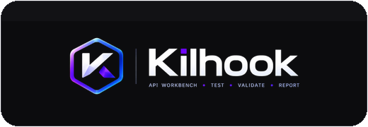
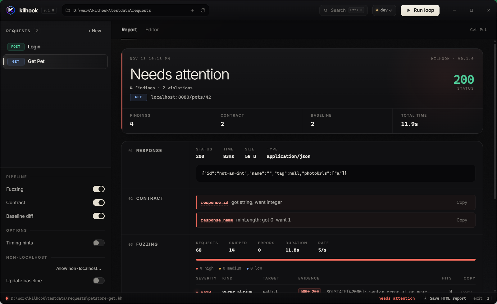

<p align="center"></p>

# kilhook

Local-first API workbench for Windows: author a request once, then fuzz it,
validate it against your OpenAPI contract, and diff it against the last good
response — one file, one loop, one report.

The request is a plain-text `.kh` file: YAML frontmatter, `---`, then the raw
body. It carries the fuzz targets and the spec source, so there is no export or
re-entry between phases.

```yaml
format: 1
name: Get Pet
method: GET
url: "{{base_url}}/pets/{{pet_id}}"
fuzz:
  targets: [path.1, query.expand]
spec:
  source: "../specs/petstore.yaml"
  operation: "/pets/{id} get"
---
```

No account, no telemetry, no server, no database. Workspaces are folders.

Use kilhook only on APIs you own or have explicit permission to test.

## Try it

Prebuilt Windows binaries are on the
[v0.1.0 release](https://github.com/24Bit-System/kilhook/releases/tag/v0.1.0):
`kh-app.exe` is the desktop window and `kh-cli.exe` is the headless loop. They
are unsigned, so SmartScreen warns on first run; build from source if you would
rather not bypass it.

```powershell
.\kh-cli.exe run testdata\requests\petstore-get.kh --env dev
```

Or build the CLI from source with Go:

```powershell
go install github.com/24Bit-System/kilhook/cmd/kh-cli@latest
```

If you want to test it and report back, `docs/beta-testing.md` has the eight
steps we care about. What is planned next is in [ROADMAP.md](ROADMAP.md).

## Status

| Piece | State |
| --- | --- |
| `internal/format` — `.kh` parse/serialize, warnings | done |
| `internal/engine` — the loop + document model, shared by CLI and app | done |
| `internal/http` — request engine, env interpolation, auth | done |
| `internal/fuzz` — resolver, runner, heuristics, wordlists | done |
| `internal/spec` — kin-openapi parse + jsonschema response validation | done |
| `internal/diff` — JSON-aware and text diff | done |
| `internal/report` — unified report + standalone HTML | done |
| `cmd/kh-cli` — the whole loop, headless | done |
| `cmd/kh-app` — Wails v3 desktop window (run, edit, save, export) | done |
| MSIX package (unsigned; signing + Store not started) | done |

Two scripts matter: `scripts/verify.ps1` (offline gate) and `scripts/smoke.ps1`
(full loop against four public APIs; the only networked check).

## Build and run

Headless:

```powershell
go build -o bin/kh-cli.exe ./cmd/kh-cli
bin/kh-cli.exe run testdata/requests/petstore-get.kh --env dev
```

Desktop (Go **1.26.9+** with toolchain **go1.26.11**, per `go.mod`; the frontend
build needs Node 20+). With the default `GOTOOLCHAIN=auto`, an older Go will
download that toolchain automatically — set `GOTOOLCHAIN=local` if you need a
fully offline build and already have 1.26.11 installed.

```powershell
cd cmd/kh-app/frontend; npm ci; npm run build; cd ../../..
cd cmd/kh-app
wails3 generate syso -arch amd64 -icon build/windows/icon.ico `
  -manifest build/windows/wails.exe.manifest `
  -info build/windows/info.json -out wails_windows_amd64.syso
cd ../..
go build -o bin/kh-app.exe ./cmd/kh-app
bin/kh-app.exe
```

The `.syso` step embeds the icon and the per-monitor DPI manifest. Without it a
`go build` produces a DPI-unaware window, which is physically larger than the
screen on a 125%-scaled display.



See `docs/quickstart.md`, `docs/kh-format.md`, `docs/fuzzing-guide.md`,
`docs/desktop-app.md`, `docs/beta-testing.md` and `docs/security-review.md`.

## Verify

```powershell
pwsh -File scripts/verify.ps1
```

vet · `go test -race` · golangci-lint · `go mod tidy` check · govulncheck ·
no-wails-in-internal check · 80% coverage floor on format/spec/diff/fuzz/http/engine ·
a content-hash check that `cmd/kh-app/frontend/dist` matches its sources (git does
not preserve mtimes, so a fresh clone cannot trip it) ·
`svelte-check` on the frontend · Vitest unit tests for the frontend helpers.

The gate is PowerShell-driven and Windows-first. On Linux/macOS you can still run
all `internal/...` and `cmd/kh-cli` tests plus the frontend checks; `cmd/kh-app`
needs Wails' GTK/WebKitGTK development headers to compile.

## Layout

```
cmd/kh-cli/      headless binary (Phase 0 deliverable)
cmd/kh-app/      Wails v3 window; frontend/ is Svelte 5 + Vite
cmd/kh-app/frontend/vendor/deepmerge/  locally patched (PATCH.md); `.npmrc`
                sets install-links=true so `npm ci` installs it reproducibly
internal/        pure Go engine and report model — no UI, no Wails, no globals
scripts/         verify.ps1, the only gate (no CI)
testdata/        petstore spec, sample requests, environments
docs/            format reference, fuzzing guide, quickstart, desktop app, security review
```

`internal/*` must never import wails; `scripts/verify.ps1` enforces it. The
frontend `dist/` and the generated `.syso` are tracked because `cmd/kh-app`
embeds them at compile time; `npm run build` refreshes `dist/` and its content
hash.

## Who made this

kilhook is an app built by **24Bit System**, the brand of **Two Four Bit Systech
India Private Limited**. Reach us at
[info@24bitsystem.com](mailto:info@24bitsystem.com) or
[www.24bitsystem.com](https://www.24bitsystem.com). Contributors are listed in
[AUTHORS.md](AUTHORS.md).

## Contributing

[CONTRIBUTING.md](CONTRIBUTING.md) has the build and test workflow.
[SECURITY.md](SECURITY.md) explains where to send vulnerability reports.

## License

MIT. Copyright (c) 2026 Two Four Bit Systech India Private Limited; see
[LICENSE](LICENSE). The logo, favicon and screenshots under `docs/` use the same
license. Bundled third-party notices:
`cmd/kh-app/frontend/vendor/deepmerge/license.txt` and
`cmd/kh-app/frontend/Inter Font License.txt`.
