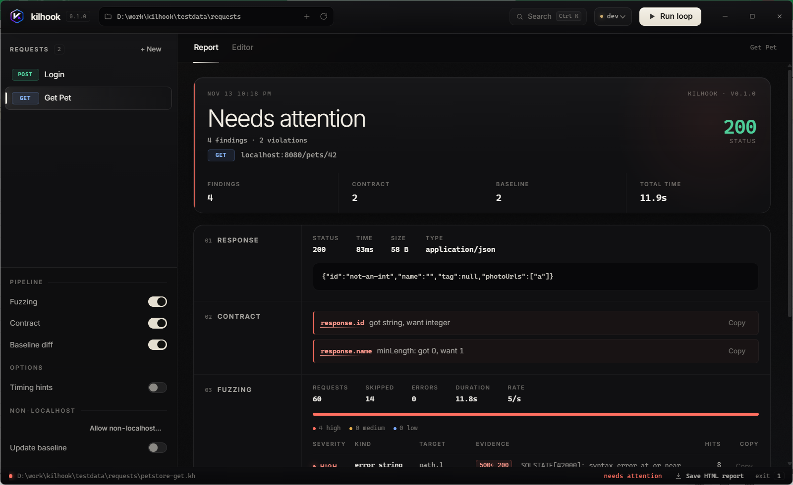
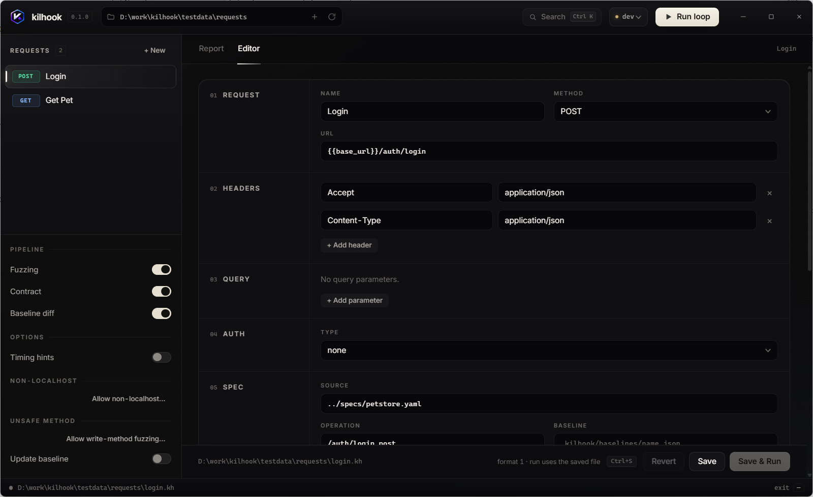

<p align="center"></p>

# The desktop app

`cmd/kh-app` is a Wails v3 window over the same engine `kh-cli` runs. It is not a
second implementation: it binds `internal/engine.Run`, renders the JSON that
`internal/report` already produces, and writes the same HTML export.





## Build

The Go side embeds `frontend/dist`, so the frontend must be built first. Go
1.26+ is required by Wails v3.1.0.

```powershell
cd cmd/kh-app/frontend
npm ci
npm run build          # writes frontend/dist
cd ../../..

cd cmd/kh-app
wails3 generate syso -arch amd64 -icon build/windows/icon.ico `
  -manifest build/windows/wails.exe.manifest `
  -info build/windows/info.json -out wails_windows_amd64.syso
cd ../..
go build -o bin/kh-app.exe ./cmd/kh-app
bin/kh-app.exe
```

The `.syso` carries the icon and the per-monitor DPI manifest; a bare `go build`
without it makes the window 1280 physical pixels wide at 125% scaling, which
clips the right edge on a 1366x768 or 1536x864 display.

If you change a bound Go method's signature or a model type, regenerate the JS
bindings before building the frontend:

```powershell
cd cmd/kh-app
wails3 generate bindings -d frontend/bindings -clean=true -ts -i ./...
```

`wails3` comes from `go install github.com/wailsapp/wails/v3/cmd/wails3@v3.1.0`.
The app requires Wails v3 ≥ beta.21 (the MSIX command-registration fix); this
tree is on v3.1.0.

## What it does

| Control | Effect |
| --- | --- |
| Workspace box + **Reload** | Lists the `.kh` files in a folder. No recursion. |
| **Browse…** | Native folder picker; selecting a folder loads it. Cancelling changes nothing. |
| **Search / Ctrl+K** | Command palette: jump to a request, run, stop, switch env or tab, save, drive the window |
| File list | Pick the request to run. A file Discover could not parse carries a red `!` and explains itself when selected. |
| **Run loop** | Send → validate against the spec → fuzz → diff, all in one pass |
| **Stop** | Cancels an in-flight run; requests already in flight finish |
| env dropdown | The `.kilhook/env/*.yaml` files next to the workspace; the name in use stays selectable even when no file exists yet |
| Fuzzing / Contract / Baseline diff switches | Same as `--no-fuzz`, `--no-spec`, `--no-diff` |
| timing hints | Enables the advisory timing heuristic (off by default) |
| allow non-localhost | Same guard as `--allow-nonlocal`; requires typing `allow` |
| unsafe method | For POST/PUT/PATCH/DELETE, requires typing `allow` before fuzzing; the report also carries a warning |
| update baseline | Stores this response as the last-known-good baseline |
| **Save HTML report** | Opens a native save dialog (default name `kilhook-report.html`) and writes the standalone report wherever you choose |
| **Copy** on a finding | Copies a plain-text block (severity, kind, target, payload, status, hits, evidence) to the system clipboard |
| **Violation path** | Click a contract-violation JSON path to highlight and scroll to that field in the response preview; **Copy** copies the violation as text |
| **Editor** tab | Form over the `.kh` frontmatter and body; **Save** writes it back |

The window opens on the working directory, or on `requests/` or
`testdata/requests/` if that is where the `.kh` files are.

## Editing

The Editor tab is a form over the parsed file: name, method, URL, headers, query,
auth, body, fuzz targets/methods/limits, spec source/operation/baseline, timeout
and redirects. Saving goes through `internal/format`'s serializer, so:

- The result is re-parsed before it is written; a save can never produce a file
  this build cannot load.
- The write is atomic (temp file + rename in the same directory).
- The body is written back byte for byte, exactly as typed.
- Values equal to the documented defaults are omitted, so a file does not grow
  `max_requests: 500` just because it was opened once. Saving twice in a row
  produces identical bytes (there is a test for this).
- Unknown fields are listed in a warning banner before you save, because the
  rewrite does drop them.

The form is not a live preview: **Run always uses the saved file**, so save
before running. Editing during a run is allowed, but saving is rejected until
it stops; a warning names the unsaved-changes case before each run.

An `unsaved changes` chip appears in the footer as soon as the form differs from
the file, and **Revert** is only enabled while it is there. `Ctrl+S` saves;
**Save & Run** saves and then starts the loop, which is the common case enough
to deserve a button. Write-access and document shape live in
`internal/engine/document.go`, not in the component, so the CLI can grow an
edit command without a second implementation.

## What it does not do yet

- **The MSIX is unsigned.** `wails3 tool msix` produces
  `bin/kh-app-amd64.msix` (11.7 MB, identity `com.kilhook.app`, version
  `0.1.0.0`, x64) through the Windows SDK's `MakeAppx.exe`; installing it needs
  a trusted certificate. Signing and Store submission are not started.
- The window is frameless with a custom title bar: minimize, maximize and close
  are DOM buttons calling the Wails runtime. On launch it is fitted to the
  primary work area so a small or scaled display does not clip the window.

## Packaging

`cmd/kh-app/build/` holds the Wails build assets, including `config.yml`, which
drives the generated resources. The same identity is also set explicitly in
`build/windows/info.json`, `wails.exe.manifest`, the MSIX/NSIS manifests and
`cmd/kh-app/main.go`; keep them in sync. The package is built with:

```powershell
go build -o bin/kh-app.exe ./cmd/kh-app
wails3 tool msix --config cmd/kh-app/build/config.yml `
  --name kh-app.exe --executable bin/kh-app.exe `
  --arch x64 --out bin/kh-app-amd64.msix --publisher "CN=24Bit System"
```

The executable is 22.7 MB, inside the 30 MB v1 budget.

The package installs and runs. Two routes were tried on Windows 11:

| Route | Result |
| --- | --- |
| `Add-AppxPackage -Path kh-app-amd64.msix` (the signed package) | Fails with `0x800B0109` unless the signing root is trusted in the **machine** store, which needs administrator rights. Fine for the Store, which re-signs. |
| `Add-AppxPackage -Register <unpacked>\AppxManifest.xml` (developer mode) | Installs, no admin needed. The Start-menu entry launches the window, which shows `kilhook 0.1.0`, loads a workspace and runs the loop (200 in 19 ms, one contract violation, five fuzz findings). |

The window itself is the same one shown at the top of this document; the
package only changes how it is launched.

Developer mode was already enabled on this machine (`AllowDevelopmentWithoutDevLicense = 1`).
The package was uninstalled and the self-signed certificate deleted from all three
certificate stores afterwards. A clean-VM install of a *trusted* package is still
unproven, so the pre-submission checklist item stays open.

That test also caught a real defect: a packaged app starts with the working
directory in `C:\Windows\System32`, and the workspace box offered that path.
`Workspace.Home` now rejects Windows, Program Files and ProgramData directories
and falls back to the user profile (covered by `cmd/kh-app/service_test.go`). `build/config.yml` is
committed (there is no VCS here; it lives in the tree) because the MSIX tool
reads the identity from it and its absence is the classic "package has the
template company name" bug.

## Verifying a UI change

Compiling proves the bindings line up; it does not prove the window looks right.
Run the app, take a screenshot, and look at it:

```powershell
go build -o bin/kh-app.exe ./cmd/kh-app
./bin/kh-app.exe
# then screenshot the window and inspect the result
```

The checks that actually caught problems while building these screens: the
default workspace opened on an empty folder, the findings table was below the
fold with no scroll affordance in the window chrome, and a placeholder string
containing `{id}` was parsed as a JS expression, which threw inside the editor
and left the previous tab on screen with no visible error.

`frontend/src/main.ts` installs error and unhandledrejection handlers that render
a red bar at the bottom of the window. Keep them: a Svelte render that throws
does not blank the app, it leaves stale DOM, so without the bar a broken tab
looks like a dead button.
